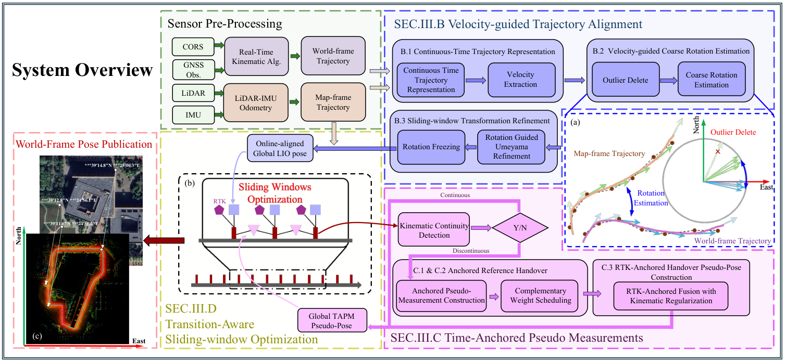

# GeoBridge-LIO

**Transition-Aware World-Frame RTK–LiDAR–Inertial Odometry across Indoor–Outdoor Environments**

GeoBridge-LIO combines LiDAR–inertial odometry with single-antenna RTK for world-frame pose estimation across indoor and outdoor environments. It uses velocity-guided trajectory alignment to establish the map-to-world transformation and time-anchored pseudo-measurements to support continuous pose output during RTK loss and recovery.

**Related paper:** [GeoBridge-LIO](paper/GeoBridge-LIO.pdf)

**Video:** [Watch the experiment video](https://raw.githubusercontent.com/yxzhang0322/GeoBridge-LIO/main/readme/GeoBridge_LIO.mp4)

**Pipeline:**



**Key features:**

1. Velocity-guided Trajectory Alignment (VTA) for short-window map-to-world alignment.
2. Time-Anchored Pseudo-Measurements (TAPM) for RTK outage and recovery transitions.
3. World-frame pose estimation with a FAST-LIO2 front end and an integrated sliding-window backend.

## 1. Prerequisites

### 1.1 Ubuntu and ROS

The catkin build targets **Ubuntu 20.04** and **ROS Noetic**, with a **C++14** compiler. Install ROS Noetic and initialize `rosdep` before building.

### 1.2 Libraries

- **C++:** Eigen3, PCL, Ceres Solver, glog, and Boost.
- **Python:** Python 3 development headers, NumPy, SciPy, Matplotlib, pandas, and PyYAML.

```bash
sudo apt install build-essential cmake python3-dev python3-pip \
  libeigen3-dev libpcl-dev libceres-dev libgoogle-glog-dev \
  libboost-all-dev python3-numpy python3-scipy python3-matplotlib \
  python3-pandas python3-yaml
```

### 1.3 Sensor drivers

Install [Livox ROS Driver](https://github.com/Livox-SDK/livox_ros_driver) and [gnss_comm](https://github.com/HKUST-Aerial-Robotics/gnss_comm) from their upstream repositories. For live RTK acquisition, use [ublox_driver](https://github.com/HKUST-Aerial-Robotics/ublox_driver). Follow the driver instructions to install Livox-SDK. IKFoM and ikd-Tree are loaded from an external [FAST-LIO](https://github.com/hku-mars/FAST_LIO) checkout.

## 2. Build

Clone the repository and build the catkin workspace:

```bash
source /opt/ros/noetic/setup.bash
git clone https://github.com/yxzhang0322/GeoBridge-LIO.git
cd GeoBridge-LIO
git clone --recursive https://github.com/hku-mars/FAST_LIO.git external/FAST_LIO
git clone https://github.com/Livox-SDK/livox_ros_driver.git src/livox_ros_driver
git clone https://github.com/HKUST-Aerial-Robotics/gnss_comm.git src/gnss_comm
rosdep install --from-paths src --ignore-src -r -y
catkin_make -DCMAKE_BUILD_TYPE=Release \
  -DFASTLIO_SOURCE_DIR="$PWD/external/FAST_LIO" \
  -DPYTHON_EXECUTABLE=/usr/bin/python3 \
  -DPYTHON_INCLUDE_DIR=/usr/include/python3.8 \
  -DPYTHON_LIBRARY=/usr/lib/x86_64-linux-gnu/libpython3.8.so
source devel/setup.bash
```

## 3. Directly run

### 3.1 Configuration

The single recording configuration is [bridge.yaml](src/RTK_LIO/config/bridge.yaml), for the Bridge dataset. Configure the input topics, sensor extrinsics, synchronization, and RTK settings for the recording. Trajectory exports are controlled by the `export` block.

The default MID-360 configuration uses:

| Input | ROS topic |
| --- | --- |
| LiDAR | `/livox/lidar` |
| IMU | `/livox/imu` |
| RTK | `/ublox_driver/receiver_pvt` |

### 3.2 Rosbag example

Start `roscore` and source `devel/setup.bash` in each terminal. Launch GeoBridge-LIO:

```bash
rosparam set use_sim_time true
roslaunch fast_lio mapping_bridge.launch rviz:=true
```

Play the recording in another terminal:

```bash
rosbag play --clock /absolute/path/to/recording.bag
```

## 4. Trajectory evaluation

The evaluator accepts trajectories in TUM format: `timestamp tx ty tz qx qy qz qw`.

```bash
python3 src/RTK_LIO/tools/trajectory_eval.py \
  --gt /absolute/path/to/reference.tum \
  --est /absolute/path/to/estimate.tum \
  --out /absolute/path/to/new_evaluation_directory
```

Use `--position-only` for position references without measured attitude.

## 5. Dataset and videos

**Dataset:** Download the self-collected Bridge recordings from [Google Drive](https://drive.google.com/drive/folders/1vN27Txuj9iULoNYrEILlKrB7BTbfd7qn?usp=sharing).

**Video:** [GeoBridge-LIO experiment video](https://raw.githubusercontent.com/yxzhang0322/GeoBridge-LIO/main/readme/GeoBridge_LIO.mp4).

## 6. Acknowledgements and licenses

GeoBridge-LIO builds on FAST-LIO2, IKFoM, ikd-Tree, Livox ROS Driver, and GNSS utilities. Third-party copyright notices and licenses are retained with their sources. See each package's license file for its terms.
